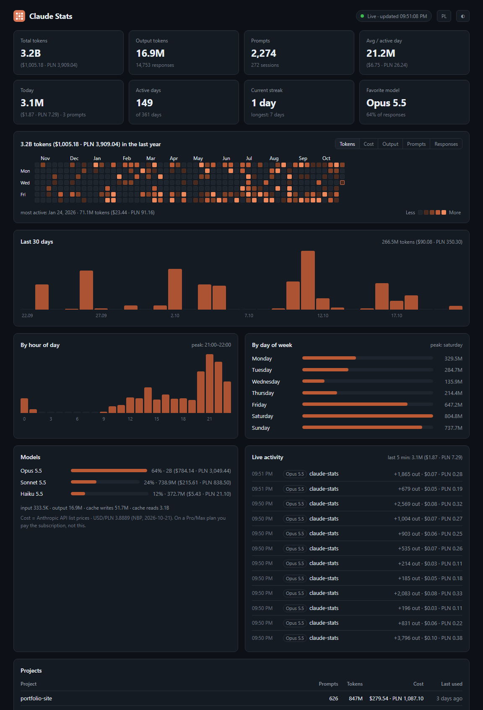

<p align="center">
  
</p>

<h1 align="center">Claude Stats</h1>

<p align="center">
  A live dashboard for your <b>Claude Code</b> usage, with a GitHub-style contribution heatmap.<br>
  Tokens, cost in USD and PLN, streaks, favorite model, busiest hours. 100% local.
</p>

<p align="center">
  <b>English</b> · <a href="README.pl.md">Polski</a>
</p>

<p align="center">
  
</p>

## Features

- 🟧 **Contribution heatmap** for the last year, colored by tokens, cost, output, prompts or responses
- ⚡ **Live updates**: each Claude Code response shows up within ~2 seconds
- 💵 **Cost** next to every token count, in USD and PLN, based on Anthropic API list prices
- 📊 Totals, today, daily average, current and longest streak, favorite model
- 🕐 Breakdowns by hour, weekday, model and project
- 🌗 Dark and light theme, English and Polish
- 🔒 **Private**: no login, no API key, no telemetry. Nothing leaves your computer
- 📦 **Zero dependencies**, only needs [Node.js](https://nodejs.org) 18 or newer

## Quick start

You need [Node.js](https://nodejs.org) (the LTS version is fine) and Claude Code installed on the same computer.

### Option 1: one command (any system)

```bash
npx github:nahekk/claude-stats
```

Your browser opens the dashboard at http://localhost:4321. Stop it with `Ctrl+C`.

### Option 2: desktop shortcut (Windows)

1. Click **Code → Download ZIP** at the top of this page and extract it, for example into `Documents`.
2. Double-click **`Create Desktop Shortcut.vbs`**.
3. From now on, double-click **Claude Stats** on your desktop.

It starts without a console window and opens your browser. Clicking it again just opens a new tab. The program stops by itself about 20 seconds after you close the tab.

> If Windows shows a SmartScreen warning for the `.vbs` files, click **More info → Run anyway**. Both are a few lines of plain text you can read in Notepad first.

### Option 3: git clone

```bash
git clone https://github.com/nahekk/claude-stats.git
cd claude-stats
node server.js
```

### Just looking? Try the demo

```bash
npx github:nahekk/claude-stats --demo
```

It shows a year of made-up data, so you can see the dashboard without Claude Code.

## Options

| Flag | Default | Description |
|---|---|---|
| `--port 5000` | `4321` | Port. If it's taken, the next free one is used. |
| `--dir <path>` | `~/.claude` | Claude config folder (also `CLAUDE_CONFIG_DIR`) |
| `--no-open` | | Don't open the browser |
| `--exit-when-closed` | | Stop when no browser tab has been open for ~20 s |
| `--demo` | | Show sample data instead of your own |

## How it works

Claude Code saves every conversation to `~/.claude/projects/**/*.jsonl`, including token usage for each model response. Claude Stats reads those files, keeps reading as they grow, deduplicates streamed messages, and pushes the stats to the page over Server-Sent Events. The server only listens on `127.0.0.1`, so no other device can reach it.

The only outgoing request is the daily USD→PLN exchange rate from the public [NBP API](https://api.nbp.pl) (National Bank of Poland). Without internet you just see USD.

### About the numbers

- **Total tokens** = input + output + cache writes + cache reads. Cache reads are usually most of it, because every turn re-reads the conversation. They are also much cheaper than fresh tokens.
- **Cost** uses Anthropic's API list prices for each model: cache writes at 1.25× input (5 min) or 2× (1 h), model-specific cache-read prices, fast mode at 2×. **On a Pro or Max plan you pay the subscription, not this amount.** It shows what the same usage would cost on the API.

### What's not included

- Chats on claude.ai, the desktop Chat tab and the mobile apps. They aren't stored on your computer, and Claude has no public API for reading account usage, so no app can show them.
- Claude Code usage from other computers. Each computer only sees its own logs.

## FAQ

**Is it safe?** Yes. It's about 1,000 lines of plain JavaScript with no dependencies, it only reads files, and the server is only reachable from your own computer. Read `server.js` if you want to check.

**Why don't I log in with my Claude account?** Claude has no official way for third-party apps to read your account usage, and a program that asks for your Claude password should never be trusted. Reading local logs needs no login at all.

**The page shows "No Claude Code activity found".** Use Claude Code at least once on this computer. If your config lives somewhere else, run it with `--dir`.

## License

[MIT](LICENSE)

Not affiliated with or endorsed by Anthropic. Claude is a trademark of Anthropic.
