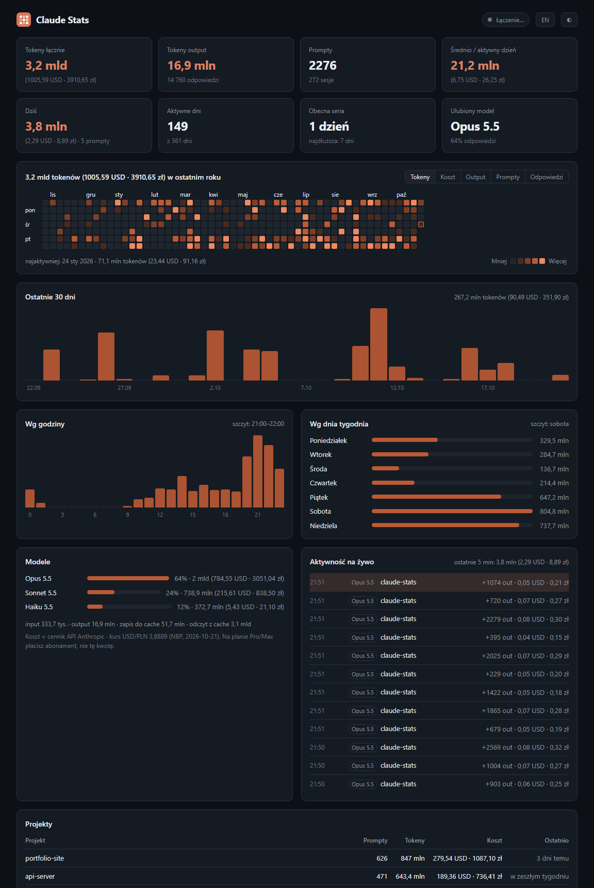

<p align="center">
  
</p>

<h1 align="center">Claude Stats</h1>

<p align="center">
  Dashboard na żywo z twoim zużyciem <b>Claude Code</b>, z heatmapą jak na GitHubie.<br>
  Tokeny, koszt w USD i zł, serie dni, ulubiony model, najczęstsze godziny. Wszystko lokalnie.
</p>

<p align="center">
  <a href="README.md">English</a> · <b>Polski</b>
</p>

<p align="center">
  
</p>

## Co potrafi

- 🟧 **Heatmapa z ostatniego roku**, kolorowana według tokenów, kosztu, outputu, promptów albo odpowiedzi
- ⚡ **Na żywo**: każda odpowiedź Claude Code pojawia się w ~2 sekundy
- 💵 **Koszt** przy każdej liczbie tokenów, w USD i zł, według cennika API Anthropic
- 📊 Sumy, dzisiaj, średnia dzienna, obecna i najdłuższa seria, ulubiony model
- 🕐 Podział na godziny, dni tygodnia, modele i projekty
- 🌗 Motyw ciemny i jasny, język polski i angielski
- 🔒 **Prywatnie**: bez logowania, bez klucza API, bez telemetrii. Nic nie wychodzi z twojego komputera
- 📦 **Zero zależności**, potrzebny tylko [Node.js](https://nodejs.org) w wersji 18 lub nowszej

## Jak uruchomić

Potrzebujesz [Node.js](https://nodejs.org) (wersja LTS wystarczy) i Claude Code na tym samym komputerze.

### Sposób 1: jedna komenda (każdy system)

```bash
npx github:nahekk/claude-stats
```

Przeglądarka otworzy dashboard pod adresem http://localhost:4321. Zatrzymujesz go przez `Ctrl+C`.

### Sposób 2: skrót na pulpicie (Windows)

1. Kliknij **Code → Download ZIP** na górze tej strony i rozpakuj, np. do `Dokumenty`.
2. Kliknij dwukrotnie **`Create Desktop Shortcut.vbs`**.
3. Od teraz klikasz **Claude Stats** na pulpicie.

Program startuje bez czarnego okna i od razu otwiera przeglądarkę. Kolejne kliknięcie otwiera tylko nową kartę. Gdy zamkniesz kartę, program sam się wyłączy po ok. 20 sekundach.

> Jeśli Windows pokaże ostrzeżenie SmartScreen przy plikach `.vbs`, kliknij **Więcej informacji → Uruchom mimo to**. To kilka linijek zwykłego tekstu, które możesz najpierw przeczytać w Notatniku.

### Sposób 3: git clone

```bash
git clone https://github.com/nahekk/claude-stats.git
cd claude-stats
node server.js
```

### Chcesz tylko zobaczyć? Tryb demo

```bash
npx github:nahekk/claude-stats --demo
```

Pokazuje rok przykładowych danych, więc zobaczysz dashboard nawet bez Claude Code.

## Opcje

| Flaga | Domyślnie | Opis |
|---|---|---|
| `--port 5000` | `4321` | Port. Jeśli jest zajęty, program weźmie następny wolny. |
| `--dir <ścieżka>` | `~/.claude` | Folder konfiguracji Claude (też `CLAUDE_CONFIG_DIR`) |
| `--no-open` | | Nie otwieraj przeglądarki |
| `--exit-when-closed` | | Wyłącz się, gdy przez ~20 s nie ma otwartej karty |
| `--demo` | | Przykładowe dane zamiast twoich |

## Jak to działa

Claude Code zapisuje każdą rozmowę w `~/.claude/projects/**/*.jsonl`, razem ze zużyciem tokenów przy każdej odpowiedzi modelu. Claude Stats czyta te pliki na bieżąco, gdy przybywa w nich danych, usuwa duplikaty i wysyła statystyki do strony przez Server-Sent Events. Serwer nasłuchuje tylko na `127.0.0.1`, więc żadne inne urządzenie się do niego nie dostanie.

Jedyne połączenie wychodzące to pobranie kursu USD/PLN z publicznego [API NBP](https://api.nbp.pl). Bez internetu zobaczysz same dolary.

### Co oznaczają liczby

- **Tokeny łącznie** = input + output + zapis do cache + odczyt z cache. Odczyt z cache to zwykle większość, bo w każdej turze model ponownie czyta rozmowę. Jest też dużo tańszy niż nowe tokeny.
- **Koszt** liczony jest według cennika API Anthropic dla każdego modelu: zapis do cache po 1,25× ceny inputu (5 min) albo 2× (1 h), osobne ceny odczytu cache dla każdego modelu, fast mode ×2. **Na planie Pro lub Max płacisz abonament, a nie tę kwotę.** To wartość tego samego zużycia według cennika API.

### Czego tu nie ma

- Rozmów na claude.ai, w zakładce Chat w aplikacji desktopowej i w aplikacji mobilnej. Nie są zapisywane na twoim komputerze, a Claude nie ma publicznego API do odczytu zużycia konta, więc żaden program ich nie pokaże.
- Zużycia Claude Code z innych komputerów. Każdy komputer widzi tylko własne logi.

## FAQ

**Czy to bezpieczne?** Tak. To ok. 1000 linijek zwykłego JavaScriptu bez zależności. Program tylko czyta pliki, a serwer jest dostępny wyłącznie z twojego komputera. Możesz sam przejrzeć `server.js`.

**Dlaczego nie loguję się na konto Claude?** Claude nie daje programom innych firm oficjalnego dostępu do zużycia konta, a programowi, który prosi o hasło do Claude, nie powinno się ufać. Lokalne logi nie wymagają żadnego logowania.

**Strona pokazuje „Nie znaleziono jeszcze aktywności Claude Code”.** Użyj Claude Code przynajmniej raz na tym komputerze. Jeśli konfigurację trzymasz w innym miejscu, uruchom program z `--dir`.

## Licencja

[MIT](LICENSE)

Projekt niezależny, niepowiązany z Anthropic. Claude jest znakiem towarowym Anthropic.
